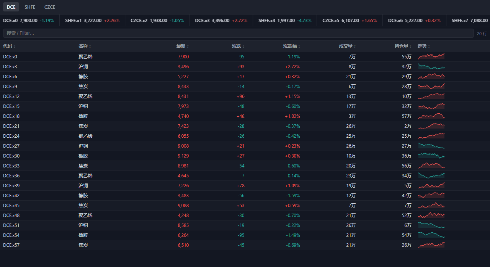
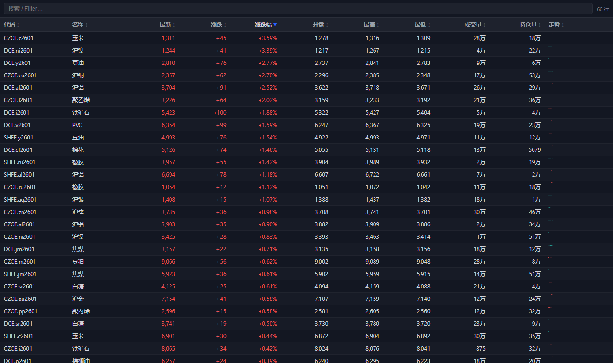
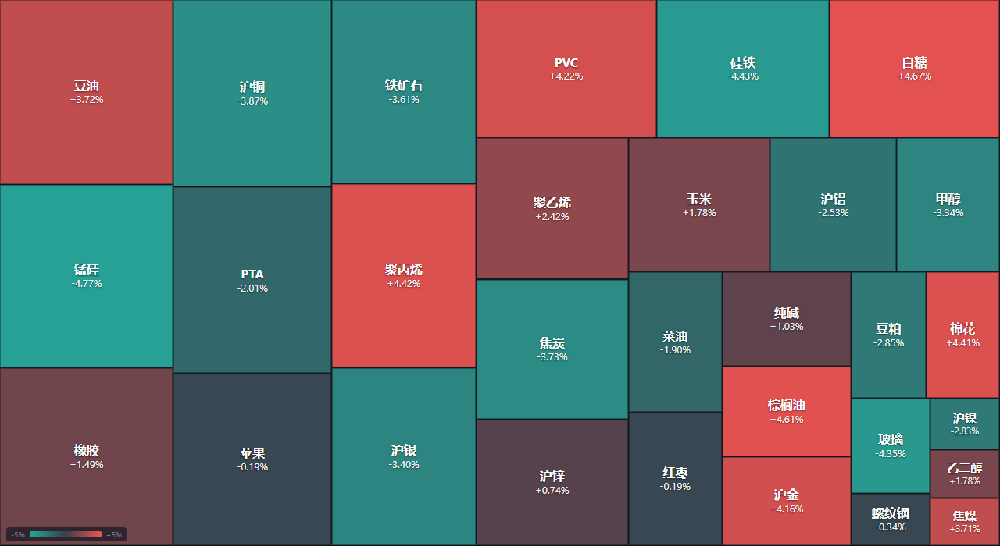
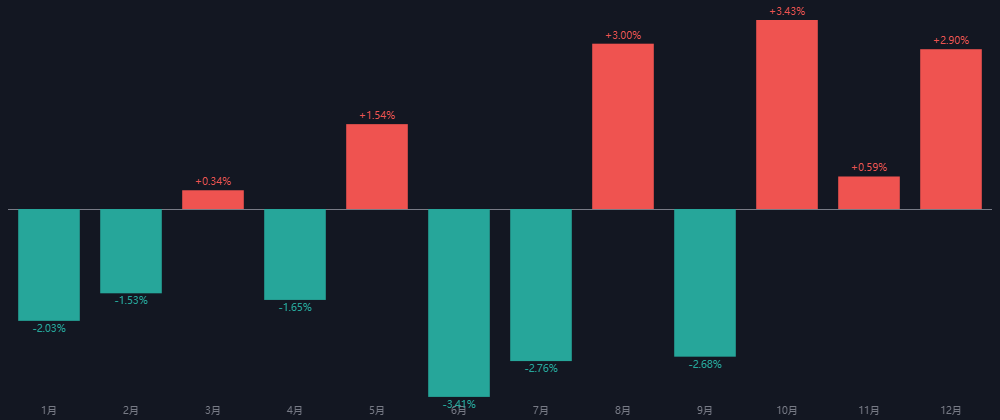
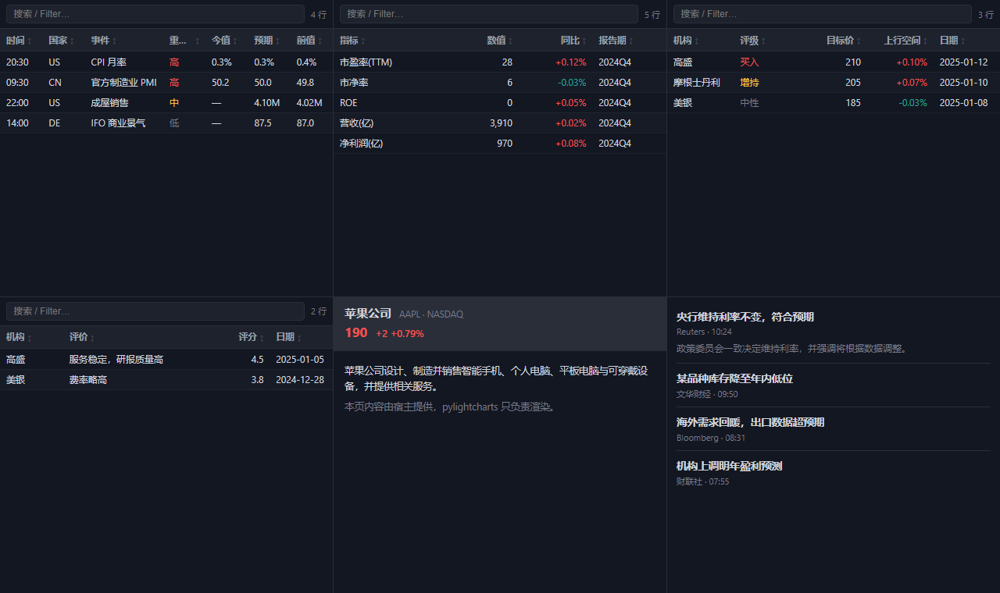
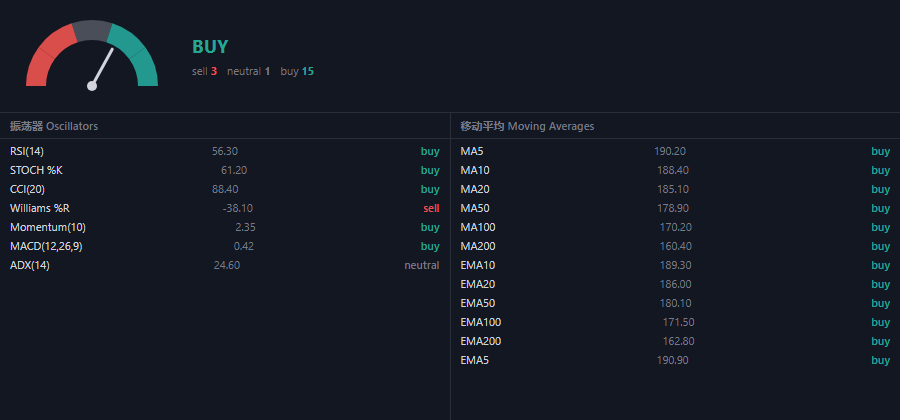

# 13 · Panels — 行情插件（DataGrid / Sparkline / Ticker / Quote / Heatmap / Seasonal / Screener）













本目录是「TradingView 金融插件」的第一批组件，落在 pylightcharts 之上、
**通用组件进库、业务数据进 miniqt**：

- **`DataGrid`** —— 可排序 / 搜索 / 虚拟滚动的数据表，内置数字、百分比、涨跌、
  行内迷你图等列类型；
- **`Sparkline`** —— 单 `<canvas>` 迷你走势，一行一个、几百个也不卡；
- **`QtPanel`** —— 一个**没有图表引擎**的 Qt WebEngine 页面，用来承载整页的
  DOM 面板（和 `QtChart` 同构，走同一套桥 / 主题 / 脚本队列）。

## 行情报价（`QuoteBoard`，0.1.6 新增）

把 `DataGrid` + `Ticker` 拼成 miniqt 那套「行情报价」页：

| 特性 | 说明 |
| --- | --- |
| **类型 chips** | 期货 / 主连 / 指数 / 期权 / 股票 / 主力 |
| **交易所 chips** | 中金所 / 上期所 / 大商所 / 郑商所 / 能源 / 广期所 / 港股 / 美股 |
| 搜索 + 行数 + 刷新 | 搜索是本地过滤（120ms 防抖）；「刷新」回调让后端绕过缓存重拉 |
| **加载中 / 暂无数据** | `set_loading(True)` 显示「正在加载 …」，数据到了自动恢复（不会永远转圈 ✓） |
| 事件 | `on_click(symbol, x, y)` / `on_double_click(symbol)` / `on_context(symbol)` / `on_filter(kind, exchange, text)` / `on_refresh()` |
| 列 | 支持期权专用列（行权价 / 到期日），用 `set_column_visibility()` 按类型切换 |

```python
from pylightcharts import QtPanel
from pylightcharts.panels import Column, QuoteBoard

panel = QtPanel()
board = QuoteBoard(panel.win, columns=[
    Column('symbol', '代码', width=1.7), Column('name', '名称', width=1.3),
    Column('last', '最新价', type='number', color_by='sign'),
    Column('chg', '涨跌', type='change'), Column('chg_pct', '涨跌幅', type='percent'),
], types=[('FUT', '期货'), ('STOCK', '股票')],
   exchanges=[('CFFEX', '中金所'), ('SHFE', '上期所')])
board.on_filter(lambda kind, exchange, text: reload(kind, exchange))
board.set_rows(rows)
```

## 商品搜索（`SymbolSearch`，0.1.6 新增）

顶栏那种「搜索商品 / 代码 / 名称」的模态框：

| 特性 | 说明 |
| --- | --- |
| 本地 / 远程 | 传 `items` 就前端过滤；不传则 `on_query` 走远程（几千个合约更省） |
| 键盘 | `↑↓` 选择、`Enter` 打开、`Esc` 关闭 |
| 事件 | `on_query(text)` / `on_pick({'symbol','name','exchange','type'})` |
| 空态 | 没有匹配时给一句提示（不是空白） |

```python
from pylightcharts.panels import SymbolSearch

search = SymbolSearch(chart.win, items=rows)     # 或 SymbolSearch(chart.win)
search.on_pick(lambda item: switch_chart(item['symbol']))
search.open('rb')                                 # 也可以预填关键字
```

## 运行

```bash
python examples/13_panels/01_data_grid.py          # 整页行情表（800 行）
python examples/13_panels/01_data_grid.py --snapshot data_grid.png
python examples/13_panels/02_sparkline.py          # 迷你走势（含实时重画）
python examples/13_panels/03_market_data.py        # 分组行情表 + 顶部滚动条
python examples/13_panels/04_ticker_and_quote.py   # Ticker 家族 + 报价头
python examples/13_panels/05_heatmap.py            # 树状热力图
python examples/13_panels/06_seasonal.py           # 季节性柱状图
python examples/13_panels/07_screener.py           # 条件筛选表（Tabs 预设 + FilterBar）
python examples/13_panels/08_details.py            # P3 壳（日历/基本面/券商/资料/新闻）
python examples/13_panels/09_technical.py          # Technical Analysis（仪表盘 + 汇总）
python examples/13_panels/10_gallery.py            # 插件总览（全部插件网格；QtChart + QtPanel）
python examples/13_panels/11_sim_account_shell.py  # 模拟账户面板（指标卡 + 持仓/委托/成交）
python examples/13_panels/12_quote_board.py        # ★ 行情报价（类型/交易所 chips + 报价表 + 滚动条）
python examples/13_panels/12_quote_board.py --check       # 只校验数据（不开窗口）
python examples/13_panels/12_quote_board.py --snapshot quote_board.png
python examples/13_panels/13_symbol_search.py      # ★ 商品搜索（切合约）
python examples/13_panels/13_symbol_search.py --check
python examples/13_panels/14_indicator_picker.py          # ★ 指标选择器（含 ★ 收藏）
python examples/13_panels/14_indicator_picker.py --templates   # 指标模板对话框
python examples/13_panels/14_indicator_picker.py --check
python examples/13_panels/15_alert_dialog.py           # ★ 价格预警（创建 / 删除）
python examples/13_panels/15_alert_dialog.py --check
python examples/13_panels/15_alert_dialog.py --snapshot alert_dialog.png
```

需要 PySide6 或 PyQt6（`PYLIGHTCHARTS_QT=PyQt6` 可切换）。

## 组件一览

| 类 | 说明 |
|---|---|
| `DataGrid` / `Column` | 可排序 / 搜索 / 虚拟滚动的数据表 |
| `QuoteBoard` | 行情报价页（类型/交易所 chips + 报价表 + Ticker + 加载/空态） |
| `SymbolSearch` / `AlertDialog` | 商品搜索 / 价格预警对话框 |
| `IndicatorPicker` / `TemplatePicker` | 指标选择器（★ 收藏）/ 指标模板 |
| `Sparkline` / `MiniChart` | canvas 迷你走势 |
| `Tabs` | 分组切换条 |
| `MarketData` | `DataGrid` + `Tabs`（交易所/板块分组） |
| `Watchlist` | `DataGrid` 预设 + add / update / remove |
| `Ticker`（`TickerTape`/`TickerTag`/`SingleTicker`/`Tickers`） | 滚动/静态报价条 |
| `QuoteHeader`（`SymbolInfo`/`SymbolOverview`） | 报价头 |
| `Heatmap`（`StockHeatmap`/`CryptoHeatmap`/`EtfHeatmap`/`ForexHeatmap`） | 树状热力图（面积=权重、颜色=涨跌） |
| `SeasonalChart` + `seasonal_monthly` | 季节性柱状图 + 按月聚合辅助 |
| `Screener` | `DataGrid` + 多条件过滤（Python 侧） |
| `TechnicalAnalysis` + `ta_summary` | 买卖仪表盘 + 振荡器/均线汇总表 |
| `10_gallery.py` | 把上面全部插件按 TradingView 目录顺序铺成一张可滚动网格（Advanced Chart 用真实 `QtChart`） |
| `FilterBar` | 筛选条件 chips（可内联添加），与 `Screener` 双向同步 |
| `NewsFeed` / `TopStories` | 新闻头条列表 |
| `TextBlock` | 富文本/HTML 块（简介、说明） |
| `EconomicCalendar` / `FundamentalData` / `CompanyProfile` / `BrokerRating` / `BrokerReviews` | P3 壳（结构就绪，宿主喂数据） |

## 最小用法

```python
from pylightcharts import QtPanel
from pylightcharts.panels import Column, DataGrid

panel = QtPanel()                      # 或复用一张图的窗口：DataGrid(chart.win, ...)
grid = DataGrid(panel.win, columns=[
    Column('symbol', '代码'),
    Column('last', '最新', type='number', color_by='sign'),
    Column('chg_pct', '涨跌幅', type='percent'),
    Column('volume', '成交量', type='number', compact=True),   # 万 / 亿
    Column('spark', '走势', type='spark'),
])
grid.set_rows(rows)                    # rows: list[dict]
grid.on_row_double_click(lambda key: open_chart(key))
panel.get_webview().show()
```

## 关键点

| 能力 | 说明 |
|---|---|
| 列类型 | `text` / `number` / `percent` / `change` / `spark` |
| 数字格式 | `compact=True` → `万` / `亿`；`decimals=` 控制小数位 |
| 配色 | `color_by='sign'` + `color_scheme='cn'`（红涨绿跌）/ `'tv'`（绿涨红跌） |
| 交互 | 点表头排序、左上角搜索框过滤、`grid.sort()` / `grid.set_filter()` |
| 虚拟滚动 | 只有可见的几十行在 DOM 里（几千行不卡） |
| 回调 | `on_row_click` / `on_row_double_click` 收到行的 `row_key` 值 |
| 主题 | `Win.theme('light'/'dark')` 时表格自动跟随 |

> 接真实数据只需把 `make_rows()` 换成天勤 `tq_api.query_quotes(...)` 或
> `minibt.LocalDatas` —— 面板只负责画，不掺业务。

## 下一个是什么

`MarketData` / `Watchlist` / `TickerTape` 等成品组件由这些原语组合而来，
见 `minibt_docs/docs/minibt_miniqt/6.10_tradingview_widgets_plan.md` 的 P1 路线图。

## 模拟账号面板（底层壳）

`11_sim_account_shell.py` —— 表格 + 操作按钮 + 右侧下单窗口的**布局壳**：
左边 Tab（持仓 / 委托 / 成交记录 / 未成委托）+ 表格（**原地更新、行数封顶**
`MAX_ROWS=200`✓），中间是操作按钮（持仓「平/反/全/组」、委托「撤/全」，跟着 Tab 换），
最右边是简单下单窗口（价格 / 手数 / 买入 / 卖出）。数据是假的，只演示界面与更新方式 ✓。

    python examples/13_panels/11_sim_account_shell.py

> ⚠ 主题要点：`setTheme(Theme.DARK)` 必须在 **QApplication 之后、建控件之前**调，
> 否则会出现「深色前景 + 浅色背景」＝白字白底一片白 ✗；纯 `QWidget` 还要自己
> 撑一下背景（`QWidget#SimAccountShell{background:…}`）✓。

### 下单窗口（`OrderTicketPanel`）

`pylightcharts/panels/order_ticket_panel.py` —— 照快期那张单子设计的紧凑下单窗口：
**可编辑合约搜索框**（假数据下拉，接入时换成看盘工具栏的商品搜索）+
**五档阶梯**（点某一行 → 价格填进去）+ 手数（默认 1 手，`-`/`+` 各调 1）+
价格（`-`/`+` 按最小变动价位调）+ **买入 / 卖出 / 平仓** 三个按钮 ✓。
对外接口 `set_book(asks, bids)` / `symbol()` / `actionRequested(name, volume, price, symbol)` ✓。
